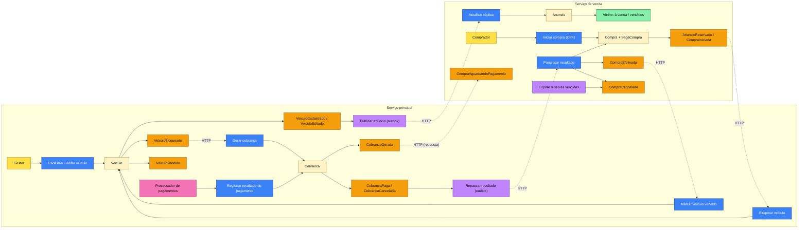
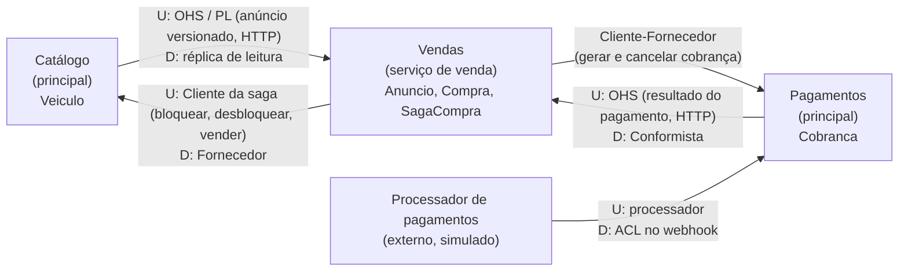
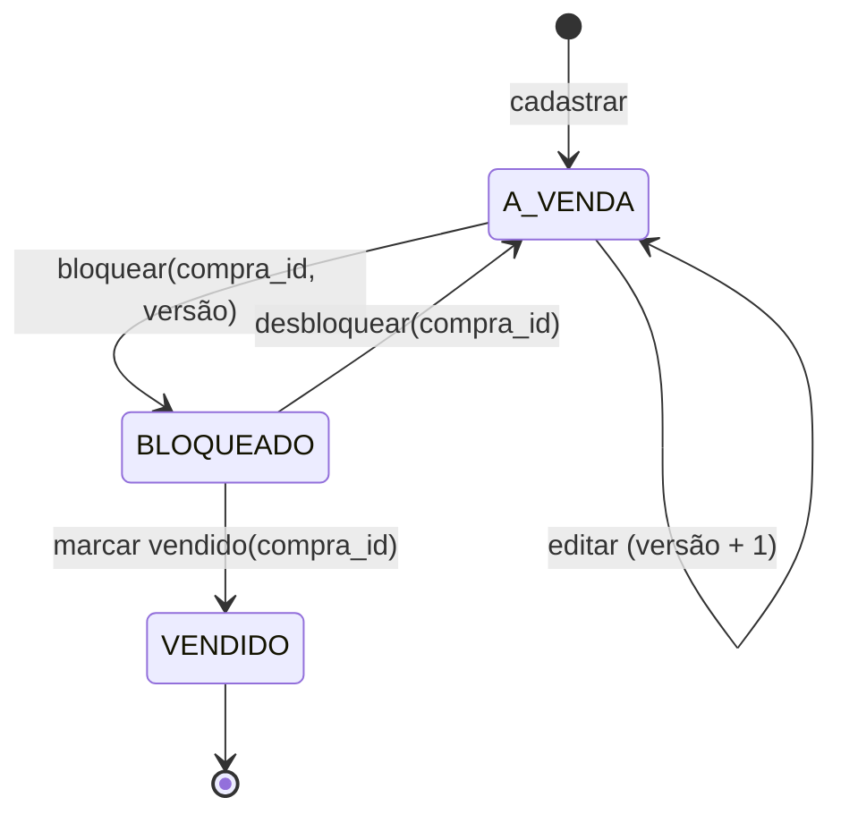
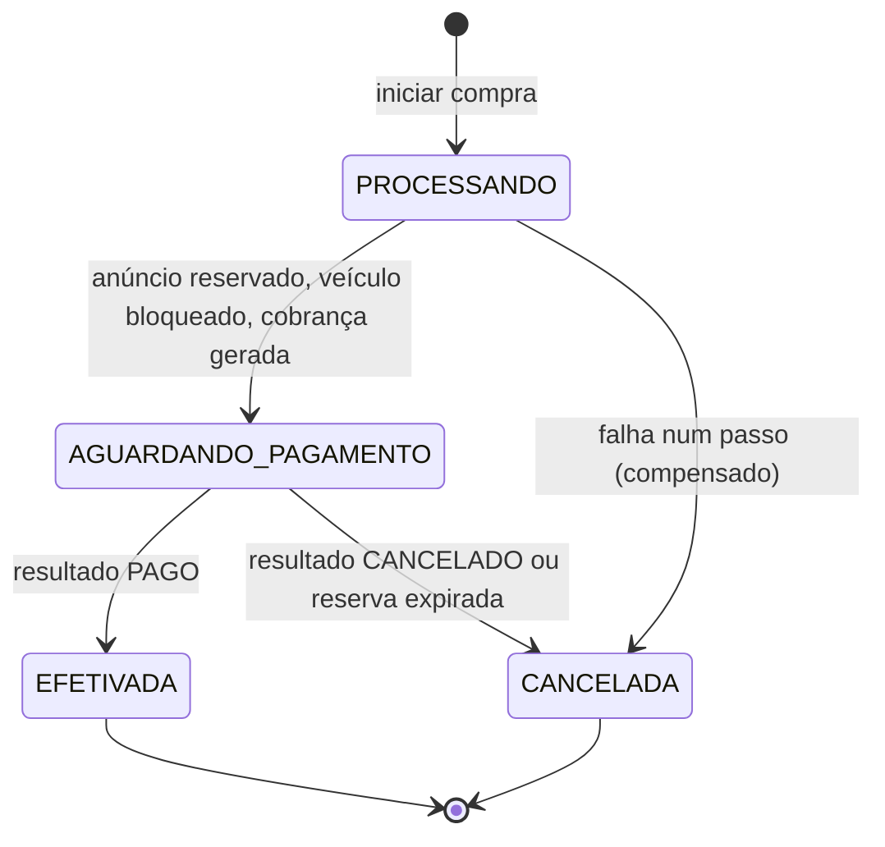
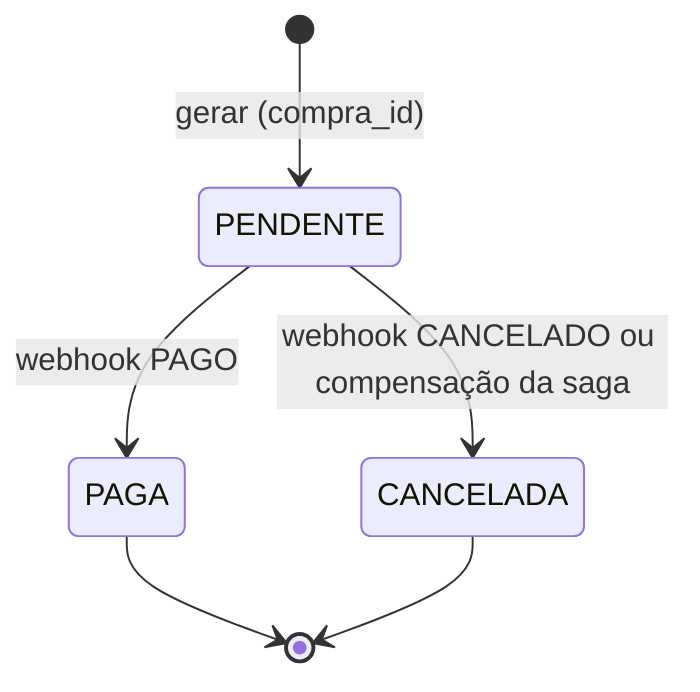
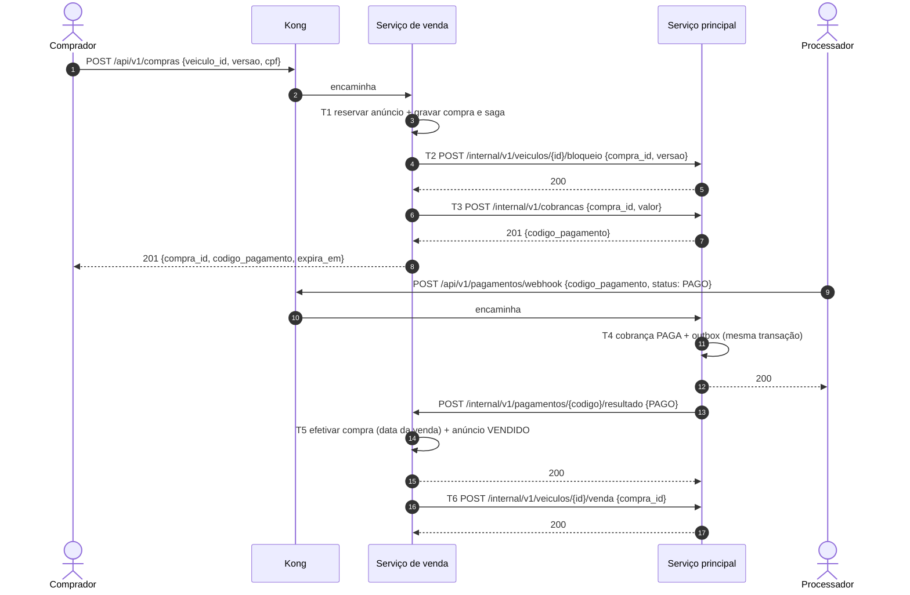

# 2. Modelagem de domínio (DDD)

Este documento registra a modelagem da solução distribuída: o fluxo de compra em Domain Storytelling, o Event Storming, a linguagem ubíqua, os subdomínios e contextos delimitados, o mapa de contextos entre os dois serviços, os agregados, as máquinas de estado, a saga da compra e as regras de negócio descobertas. É a base dos requisitos ([03-requisitos.md](03-requisitos.md)) e da estrutura do código dos dois repositórios.

O ponto de partida é a modelagem da Fase 3 ([fiap-soat-revenda-veiculos, docs/02](https://github.com/Caina-Climaco/fiap-soat-revenda-veiculos/blob/main/docs/02-modelagem-ddd.md)). Na Fase 3, Catálogo e Vendas eram módulos de um monólito modular e a compra cabia numa transação ACID única; a porta `CatalogoPort` foi desenhada para permitir extrair Vendas depois. A Fase 4 faz essa extração: a porta vira um cliente HTTP e a transação única vira uma saga.

## 2.1 O que muda em relação à Fase 3

| Tema | Fase 3 | Fase 4 |
|---|---|---|
| Comprador | Pessoa cadastrada no Keycloak; a venda guardava só o `sub` | Pessoa identificada pelo **CPF** informado na compra; não há cadastro nem login |
| Implantação | Monólito modular (Catálogo + Vendas) + Keycloak | **Serviço principal** (Catálogo + Pagamentos) + **serviço de venda** (Vendas) |
| Bancos | PostgreSQL com schemas `catalogo` e `vendas` | PostgreSQL no principal; **MongoDB** no serviço de venda |
| Consistência da compra | Uma transação ACID | **Saga orquestrada** com compensações |
| Listagens | Consultavam a tabela de veículos | Consultam uma **réplica de leitura** dos anúncios no serviço de venda |
| Pagamento | Webhook com `APROVADO` / `RECUSADO` no módulo Vendas | Webhook com `PAGO` / `CANCELADO` no contexto **Pagamentos** do principal, a partir do código do pagamento |
| Encerramentos da compra | Pagamento, recusa, expiração, desistência, cancelamento pela loja | Pagamento, cancelamento do pagamento, expiração e falha técnica (compensação) |

## 2.2 Domain Storytelling: fluxo de compra

Notação: **ator → atividade → objeto de trabalho** (com quem / onde).

### 2.2.1 Caminho feliz

| # | Ator | Atividade | Objeto de trabalho | Com / em |
|---|---|---|---|---|
| 1 | Gestor da loja | cadastra | veículo (marca, modelo, ano, cor, preço) | Catálogo (principal) |
| 2 | Catálogo | publica | anúncio (dados do veículo + versão) | Vendas (réplica), por HTTP |
| 3 | Visitante | consulta | veículos à venda, do mais barato ao mais caro | Vendas |
| 4 | Comprador | solicita a compra de | anúncio, informando o CPF | Vendas |
| 5 | Vendas | reserva | anúncio | Vendas |
| 6 | Vendas | pede o bloqueio da edição de | veículo | Catálogo, por HTTP |
| 7 | Vendas | pede a geração de | cobrança (valor congelado) | Pagamentos (principal), por HTTP |
| 8 | Pagamentos | devolve | código do pagamento | Vendas |
| 9 | Vendas | entrega ao comprador | compra aguardando pagamento, com código do pagamento e prazo | Comprador |
| 10 | Comprador | paga, informando | código do pagamento | Processador de pagamentos (fora do sistema) |
| 11 | Processador de pagamentos | notifica | pagamento **efetuado** (código do pagamento) | Pagamentos (webhook) |
| 12 | Pagamentos | registra | cobrança paga | Pagamentos |
| 13 | Pagamentos | repassa | resultado do pagamento | Vendas, por HTTP (outbox) |
| 14 | Vendas | efetiva | compra, registrando a data da venda | Vendas |
| 15 | Vendas | marca como vendido | anúncio | Vendas |
| 16 | Vendas | pede para marcar como vendido | veículo | Catálogo, por HTTP |
| 17 | Visitante | consulta | veículos vendidos, do mais barato ao mais caro | Vendas |

### 2.2.2 Variantes

| # | Variante | Sequência |
|---|---|---|
| V1 | Pagamento cancelado | 11'. O processador notifica pagamento **cancelado** → Pagamentos cancela a cobrança e repassa → Vendas cancela a compra (`PAGAMENTO_CANCELADO`), libera o anúncio e pede o desbloqueio do veículo |
| V2 | Reserva expirada | O prazo passa sem resultado → Vendas pede o cancelamento da cobrança → se aceito, cancela a compra (`RESERVA_EXPIRADA`), libera o anúncio e pede o desbloqueio; se a cobrança já estava paga, a compra segue para a efetivação |
| V3 | Compra concorrente | Dois compradores pedem o mesmo anúncio ao mesmo tempo → só um reserva; o outro recebe "veículo indisponível" (409) |
| V4 | Principal indisponível na compra | O passo 6 ou 7 falha (timeout ou circuit breaker aberto) → Vendas compensa os passos já feitos e responde 503; o anúncio volta à vitrine |
| V5 | Anúncio alterado durante a compra | O gestor edita o veículo entre a publicação da réplica e o passo 6 → o Catálogo recusa o bloqueio por versão divergente → Vendas compensa e responde 409 ("anúncio alterado, consulte novamente") |
| V6 | Gestor edita veículo reservado ou vendido | O Catálogo recusa a edição (409) |
| V7 | Notificação repetida | O processador reenvia o mesmo resultado → Pagamentos responde 200 sem efeito; o repasse ao serviço de venda é idempotente |
| V8 | Pagamento efetuado depois do cancelamento | A cobrança já está cancelada → Pagamentos responde 409 e registra a ocorrência para estorno (fora do escopo) |
| V9 | Pod do serviço de venda cai no meio da saga | Ao subir, a recuperação de sagas retoma cada saga parada do ponto em que estava (avança ou compensa) |

## 2.3 Event Storming

Nível *process modelling*: eventos (laranja), comandos (azul), atores (amarelo), agregados (amarelo-claro), políticas (lilás), sistemas externos (rosa) e modelos de leitura (verde). As setas tracejadas cruzam a fronteira entre os serviços e são **chamadas HTTP**; não há broker.

### 2.3.1 Tabela de eventos

| Evento | Serviço | Agregado | Gatilho | Efeitos |
|---|---|---|---|---|
| `VeiculoCadastrado` | principal | Veiculo | Gestor | Outbox publica o anúncio (versão 1) |
| `VeiculoEditado` | principal | Veiculo | Gestor | Versão incrementa; outbox publica o anúncio |
| `AnuncioAtualizado` | venda | Anuncio | Réplica recebida | Vitrine reflete os novos dados (descarta versão antiga) |
| `CompraIniciada` / `AnuncioReservado` | venda | Compra, Anuncio | Comprador | Saga começa; anúncio sai da vitrine |
| `VeiculoBloqueado` | principal | Veiculo | Saga (passo 2) | Edição passa a ser recusada |
| `CobrancaGerada` | principal | Cobranca | Saga (passo 3) | Código do pagamento devolvido à saga |
| `CompraAguardandoPagamento` | venda | Compra | Saga | Comprador recebe código e prazo |
| `CobrancaPaga` | principal | Cobranca | Webhook `PAGO` | **Pivô da saga**; outbox repassa o resultado |
| `CobrancaCancelada` | principal | Cobranca | Webhook `CANCELADO` ou compensação | Outbox repassa (se veio do webhook) |
| `CompraEfetivada` | venda | Compra | Resultado `PAGO` | Data da venda registrada; anúncio vendido; saga pede `VeiculoVendido` |
| `VeiculoVendido` | principal | Veiculo | Saga (passo 6) | Estado final do veículo |
| `CompraCancelada` | venda | Compra | Resultado `CANCELADO`, expiração ou falha | Compensações: anúncio liberado, veículo desbloqueado |
| `VeiculoDesbloqueado` | principal | Veiculo | Compensação | Edição volta a ser permitida |

### 2.3.2 Pontos quentes resolvidos

| Ponto quente | Resolução |
|---|---|
| Quem é dono do estado "vendido"? | O serviço de venda é dono da **disponibilidade** do anúncio (vitrine); o principal guarda o estado do veículo apenas para a regra de edição. Os dois convergem pela saga |
| Edição concorrente com a compra | O bloqueio leva a versão que o comprador viu; o Catálogo recusa se a versão mudou ([ADR-004 do serviço de venda](https://github.com/Caina-Climaco/fiap-soat-revenda-vendas/blob/main/docs/adrs/ADR-004-contramedidas-de-isolamento.md)) |
| Pagamento chega ao mesmo tempo que a expiração | A cobrança no Postgres do principal é o árbitro: só uma transição sai de `PENDENTE`. Se o pagamento ganhou, o cancelamento da cobrança é recusado e a saga avança |
| Webhook chega com o serviço de venda fora do ar | O principal grava o resultado e o repasse na mesma transação (outbox); a entrega é repetida até o serviço de venda confirmar |
| Quem gera o código do pagamento? | Pagamentos (principal), dono da cobrança; o serviço de venda só o guarda e o devolve ao comprador |

## 2.4 Linguagem ubíqua

Identificadores em português sem acento no código; termos técnicos podem ficar em inglês.

| Termo | Definição | Onde aparece |
|---|---|---|
| Veículo | Unidade física cadastrada pela loja, descrita por marca, modelo, ano, cor e preço e identificada pelo `id` (UUID) | principal: `catalogo.domain.Veiculo` |
| Versão do veículo | Número que cresce a cada edição; viaja com o anúncio e com o pedido de bloqueio | `Veiculo.versao`, `Anuncio.versao` |
| Anúncio | Cópia de leitura do veículo no serviço de venda, com a disponibilidade | venda: `Anuncio`, coleção `anuncios` |
| Vitrine | Listagens públicas: anúncios à venda e vendidos, por preço ascendente | `GET /api/v1/veiculos/a-venda`, `GET /api/v1/veiculos/vendidos` |
| Comprador | Pessoa que compra, identificada só pelo CPF | `Compra.cpf` (criptografado em repouso, mascarado nas respostas) |
| Compra | Pedido de aquisição de um anúncio por um comprador; é a "venda" do enunciado | venda: `Compra`, coleção `compras` |
| Reserva | Retirada do anúncio da vitrine enquanto a compra aguarda pagamento | `StatusAnuncio.RESERVADO` |
| Bloqueio | Trava no Catálogo que impede editar um veículo em compra | principal: `StatusVeiculo.BLOQUEADO`, `Veiculo.bloquear()` |
| Cobrança | Pedido de pagamento de um valor, identificado pelo código do pagamento | principal: `pagamentos.domain.Cobranca` |
| Código do pagamento | Identificador único da cobrança (`PAG-` + 12 hexadecimais aleatórios) | `Cobranca.codigo`, `Compra.codigo_pagamento` |
| Preço da venda | Preço congelado no início da compra | `Compra.preco` |
| Data da venda | Momento em que a compra é efetivada | `Compra.data_venda` |
| Efetivação | Conclusão da compra após o pagamento efetuado | `Compra.efetivar()`, `StatusCompra.EFETIVADA` |
| Cancelamento | Encerramento da compra sem conclusão, sempre com motivo | `Compra.cancelar(motivo)`, `MotivoCancelamento` |
| Saga da compra | Processo que coordena os passos da compra entre os serviços e as compensações | venda: `SagaCompra`, coleção `sagas` |
| Compensação | Ação que desfaz semanticamente um passo já concluído da saga | `liberar`, `desbloquear`, `cancelar cobrança` |
| Pivô | Passo a partir do qual a saga não volta mais: a cobrança paga | `CobrancaPaga` |
| Outbox | Tabela de mensagens gravadas na mesma transação do negócio e entregues depois por HTTP | principal: tabela `outbox` |
| Processador de pagamentos | Sistema externo que informa o resultado do pagamento | `POST /api/v1/pagamentos/webhook` |

## 2.5 Subdomínios e contextos delimitados

### 2.5.1 Subdomínios

| Subdomínio | Tipo | Solução |
|---|---|---|
| Vendas | **Principal (core)** | Serviço de venda, modelado com mais rigor (saga, concorrência, expiração) |
| Catálogo | Suporte | Serviço principal, modelo simples (cadastro, edição condicionada, bloqueio) |
| Pagamentos (cobrança) | Suporte | Serviço principal: cobrança e camada anticorrupção do processador |
| Processamento de pagamento | Genérico (externo) | Processador simulado por chamadas ao webhook |

### 2.5.2 Contextos delimitados

| Contexto | Serviço | Responsabilidade | Agregados | Banco |
|---|---|---|---|---|
| Catálogo | principal | Estoque, dados descritivos e versão do veículo; regra de edição | `Veiculo` | PostgreSQL `revenda_principal`, schema `catalogo` |
| Pagamentos | principal | Cobrança, código do pagamento, resultado do processador | `Cobranca` | PostgreSQL `revenda_principal`, schema `pagamentos` |
| Vendas | venda | Vitrine, compra, reserva, efetivação, saga | `Anuncio`, `Compra` (+ `SagaCompra`) | MongoDB `revenda_vendas` |
| Processador de pagamentos | externo | Cobrar o comprador e notificar o resultado | | Simulado |

A outbox do principal ([ADR-003](adrs/ADR-003-http-com-outbox.md)) fica num terceiro schema, `mensageria`, compartilhado pelos dois contextos do principal.

Catálogo e Pagamentos ficam no mesmo serviço porque o enunciado pede exatamente um serviço isolado (venda) e "o software principal" com o restante. Dentro do principal, os dois contextos continuam como módulos com schemas próprios e sem dependência direta entre si, como Catálogo e Vendas eram na Fase 3.

### 2.5.3 Mapa de contextos

Legenda: **U** = upstream, **D** = downstream.

| Relação | Padrão | Explicação |
|---|---|---|
| Catálogo → Vendas (anúncio) | **Open Host Service / Published Language** | O Catálogo publica um contrato estável de anúncio (`veiculo_id`, `versao`, marca, modelo, ano, cor, preço). O serviço de venda mantém uma réplica e descarta versões mais antigas que a que já tem |
| Vendas → Catálogo (saga) | **Cliente-Fornecedor** | A saga (cliente) usa operações internas do Catálogo (fornecedor): bloquear com versão, desbloquear, marcar vendido. As operações são idempotentes pela chave `compra_id` |
| Vendas → Pagamentos (cobrança) | **Cliente-Fornecedor** | A saga pede a cobrança (idempotente por `compra_id`) e, na compensação, o cancelamento. Pagamentos é o árbitro do pivô |
| Pagamentos → Vendas (resultado) | **Open Host Service** + **Conformista** | Pagamentos repassa o resultado normalizado (`PAGO` / `CANCELADO`, código do pagamento); Vendas usa o vocabulário como recebe |
| Processador → Pagamentos | **Anticorruption Layer** | O payload do processador é traduzido no webhook para comandos do domínio (`pagar`, `cancelar`); trocar de processador exige só outro adaptador |

## 2.6 Agregados

### 2.6.1 Veiculo (Catálogo, serviço principal)

| Atributo | Tipo | Regra |
|---|---|---|
| `id` | UUID | Gerado no cadastro |
| `marca`, `modelo`, `cor` | texto | Não vazios, com limites de tamanho |
| `ano` | inteiro | 1950 até o ano corrente + 1 |
| `preco` | decimal | Maior que zero, até 2 casas |
| `status` | `A_VENDA` / `BLOQUEADO` / `VENDIDO` | Ver máquina de estados |
| `versao` | inteiro | Começa em 1; cresce a cada edição |
| `compra_id` | UUID ou nulo | Compra que mantém o bloqueio |

Invariantes: só edita em `A_VENDA`; só bloqueia em `A_VENDA` e com a versão informada igual à atual; só desbloqueia ou vende com o mesmo `compra_id` do bloqueio; repetir uma operação com o mesmo `compra_id` não tem efeito.

### 2.6.2 Cobranca (Pagamentos, serviço principal)

| Atributo | Regra |
|---|---|
| `codigo` | `PAG-` + 12 hexadecimais; único |
| `compra_id` | Único: uma cobrança por compra (idempotência do passo 3) |
| `valor` | Preço congelado da compra |
| `status` | `PENDENTE` / `PAGA` / `CANCELADA` (finais: `PAGA`, `CANCELADA`) |
| `origem_cancelamento` | `PROCESSADOR` ou `SAGA` |

Invariante central: a saída de `PENDENTE` é um `UPDATE` condicional (`WHERE status = 'PENDENTE'`). Por isso pagamento e cancelamento concorrentes nunca terminam os dois com sucesso.

### 2.6.3 Anuncio (Vendas, serviço de venda)

Réplica do veículo (`veiculo_id`, `versao`, marca, modelo, ano, cor, preço) mais a disponibilidade (`A_VENDA` / `RESERVADO` / `VENDIDO`) e o `compra_id` da reserva. A réplica só aceita versão maior que a que tem. Os dados descritivos de um anúncio reservado ou vendido não mudam, porque o Catálogo recusa a edição nesses estados.

### 2.6.4 Compra e SagaCompra (Vendas, serviço de venda)

| Atributo da Compra | Regra |
|---|---|
| `id` | UUID; também é a chave de idempotência de todos os passos da saga |
| `veiculo_id`, `versao_anuncio` | Anúncio e versão que o comprador viu |
| `cpf` | Válido (dígitos verificadores); criptografado em repouso; nunca devolvido completo |
| `descricao` | Marca, modelo, ano e cor congelados |
| `preco` | Congelado no início |
| `codigo_pagamento` | Recebido de Pagamentos |
| `status` | `PROCESSANDO` / `AGUARDANDO_PAGAMENTO` / `EFETIVADA` / `CANCELADA` |
| `motivo_cancelamento` | `PAGAMENTO_CANCELADO`, `RESERVA_EXPIRADA`, `ANUNCIO_ALTERADO`, `FALHA_PROCESSAMENTO` |
| `criada_em`, `expira_em`, `data_venda` | `data_venda` só na efetivação |

A **SagaCompra** guarda o estado técnico do processo (passo atual, passos concluídos, tentativas, último erro, próxima tentativa) e é gravada junto com a Compra. É ela que a recuperação de sagas lê para retomar o processo depois de uma falha.

## 2.7 Máquinas de estado

### 2.7.1 Veiculo (principal)

### 2.7.2 Compra (serviço de venda)

### 2.7.3 Cobranca (principal)

## 2.8 Saga da compra

Saga **orquestrada** pelo serviço de venda ([ADR-002 do serviço de venda](https://github.com/Caina-Climaco/fiap-soat-revenda-vendas/blob/main/docs/adrs/ADR-002-saga-orquestrada.md)). Os tipos de transação seguem a classificação vista em aula: **compensável** (pode ser desfeita), **pivô** (ponto sem volta) e **retentável** (depois do pivô; é repetida até concluir).

| # | Passo | Serviço | Tipo | Compensação |
|---|---|---|---|---|
| T1 | Reservar anúncio (`A_VENDA` → `RESERVADO`, condicional) e criar a compra | venda | compensável | C1: liberar anúncio |
| T2 | Bloquear veículo com `compra_id` e versão | principal | compensável | C2: desbloquear veículo |
| T3 | Gerar cobrança (devolve o código do pagamento) | principal | compensável | C3: cancelar cobrança |
| T4 | Cobrança paga (webhook `PAGO`) | principal | **pivô** | |
| T5 | Efetivar compra e marcar anúncio vendido | venda | retentável | |
| T6 | Marcar veículo vendido | principal | retentável | |

**Parte síncrona.** T1 a T3 rodam dentro da requisição `POST /api/v1/compras`. Se todos passam, a resposta é 201 com o código do pagamento e o prazo. Se T2 ou T3 falham, a saga executa as compensações na ordem inversa (C2 se T2 concluiu, depois C1) e responde 409 (versão divergente) ou 503 (principal indisponível).

**Parte assíncrona.** T4 acontece quando o processador chama o webhook. Pagamentos grava `PAGA` e o repasse na outbox, na mesma transação, e entrega `PAGO` ao serviço de venda por HTTP até receber confirmação. O serviço de venda executa T5 e T6. T6 é retentável: se o principal estiver fora, a recuperação de sagas repete até concluir.

**Cancelamento e expiração.** Com `CANCELADO` vindo do processador, a cobrança já está cancelada; a saga executa C2 e C1. Na expiração, a saga tenta C3 primeiro. Se Pagamentos responder que a cobrança já está paga (o pivô aconteceu), a saga desiste de compensar e segue para T5 e T6.

**Durabilidade.** O estado da saga é gravado antes de cada chamada externa. Um job de recuperação procura sagas paradas (por exemplo, após a queda de um pod) e as retoma: compensando, se ainda não passaram do pivô, ou avançando, se já passaram.

**Isolamento.** Sem o "I" do ACID entre os serviços, as anomalias possíveis (leitura suja e atualização perdida) são tratadas com contramedidas: **trava semântica** (`RESERVADO` e `BLOQUEADO` são estados visíveis que impedem outra compra e a edição), **versão** (o bloqueio só passa se a versão vista pelo comprador ainda é a atual) e **ordem dos passos** (o passo que pode falhar por regra de negócio vem antes do pivô).

## 2.9 Regras de negócio

As regras RN-01 a RN-21 da Fase 3 foram revisadas: as que dependiam do Keycloak saíram, e as que envolvem a compra foram reescritas para o modelo distribuído.

| ID | Regra | Origem |
|---|---|---|
| RN-01 | **Preço congelado**: o preço da compra é o do anúncio no momento em que ela começa | Fase 3 |
| RN-02 | **Edição só com veículo à venda**: veículo `BLOQUEADO` ou `VENDIDO` não pode ser editado (409) | Fase 3 |
| RN-03 | **Uma compra ativa por veículo**: no máximo uma compra `PROCESSANDO`, `AGUARDANDO_PAGAMENTO` ou `EFETIVADA` por veículo, garantido no MongoDB por reserva condicional e índice único parcial | Fase 3, adaptada |
| RN-04 | **Reserva expira**: sem resultado do pagamento em 30 min (configurável), a compra é cancelada com `RESERVA_EXPIRADA`, salvo se a cobrança já estiver paga | Fase 3, adaptada |
| RN-05 | **Comprador pelo CPF**: a compra exige CPF válido (formato e dígitos verificadores); não há cadastro prévio | Enunciado da Fase 4 |
| RN-06 | **CPF protegido**: o CPF é gravado criptografado e só aparece mascarado nas respostas (`***.456.789-**`); não entra em logs, métricas nem traces | LGPD |
| RN-07 | **Data da venda**: é registrada pelo sistema no momento da efetivação, não informada pelo cliente | Enunciado da Fase 4 |
| RN-08 | **Estados finais**: `VENDIDO`, `EFETIVADA`, `CANCELADA`, `PAGA` não admitem transição | Fase 3 |
| RN-09 | **Notificação idempotente**: o mesmo resultado repetido para a mesma cobrança responde 200 sem efeito | Fase 3 |
| RN-10 | **Pagamento após cancelamento**: `PAGO` para cobrança cancelada responde 409 e é registrado para estorno (fora do escopo) | Fase 3, adaptada |
| RN-11 | **Cancelamento do pagamento libera o veículo**: o anúncio volta à vitrine e o veículo é desbloqueado | Enunciado da Fase 4 |
| RN-12 | **Versão vista pelo comprador**: a compra informa a versão do anúncio; se o veículo foi editado depois, a compra é recusada (409) e nada fica reservado | Modelagem da Fase 4 |
| RN-13 | **Webhook só com credencial**: sem a credencial do processador, 401 sem alteração de estado | Fase 3 |
| RN-14 | **Código do pagamento único e imprevisível**: `PAG-` + 12 hexadecimais aleatórios | Fase 3 |
| RN-15 | **Validação do veículo**: ano entre 1950 e o ano corrente + 1; preço maior que zero com até 2 casas; textos não vazios | Fase 3 |
| RN-16 | **Veículo nasce à venda** e é publicado na vitrine assim que a réplica chega | Fase 3, adaptada |
| RN-17 | **Ordenação determinística**: preço ascendente, depois data de cadastro e `id` | Fase 3 |
| RN-18 | **Identidade do veículo pelo `id`**, sem placa, chassi ou RENAVAM | Fase 3 |
| RN-19 | **Sem retirada do anúncio** nem exclusão de veículo | Fase 3 |
| RN-20 | **Vendidos pelo preço da venda**: a listagem de vendidos ordena pelo preço congelado da compra efetivada | Modelagem da Fase 4 |
| RN-21 | **Compra consultável pelo identificador**: `GET /api/v1/compras/{id}` devolve status, código do pagamento, prazo e CPF mascarado; não existe busca por CPF | LGPD |
| RN-22 | **Vitrine independente do principal**: listagens e consulta de compra funcionam com o serviço principal fora do ar | Enunciado da Fase 4 (isolamento) |
