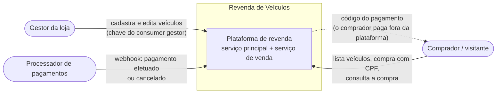
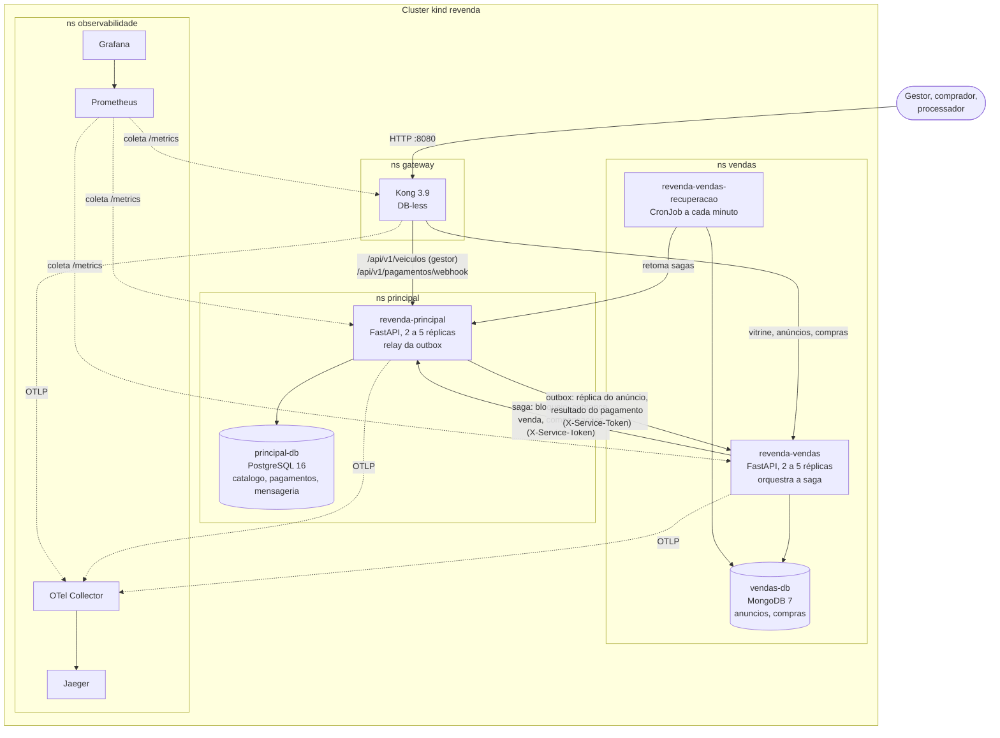
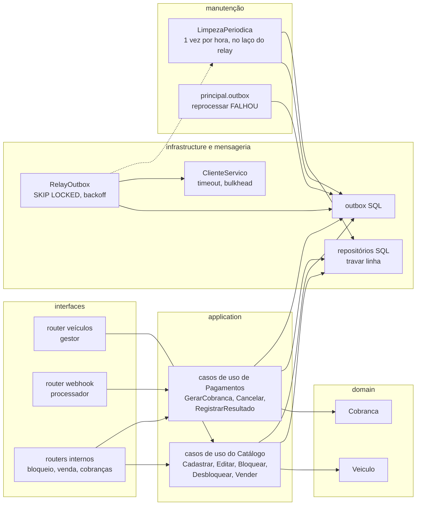
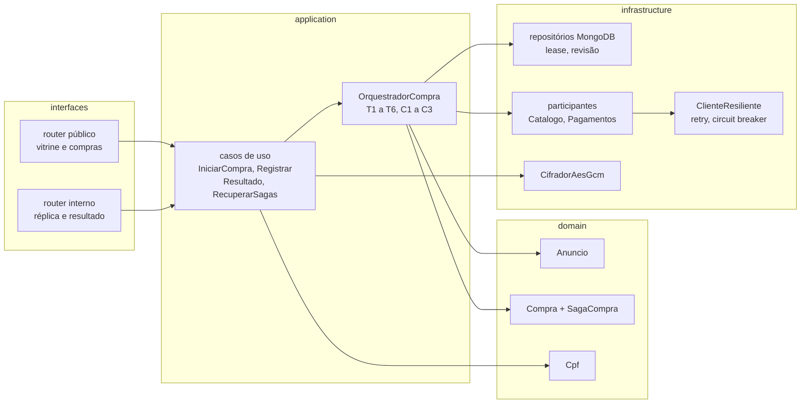
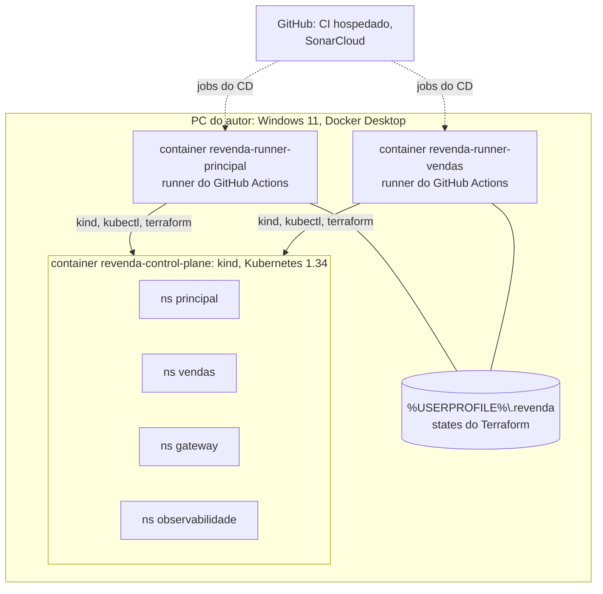
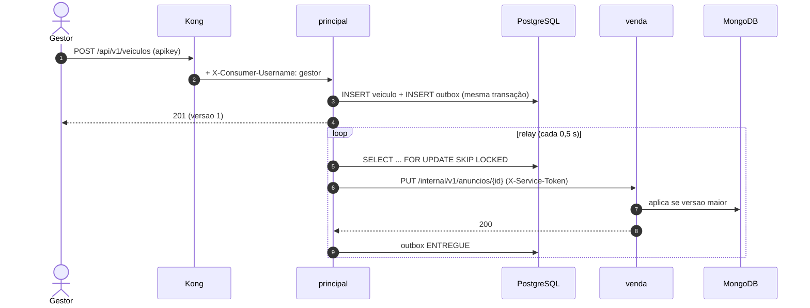
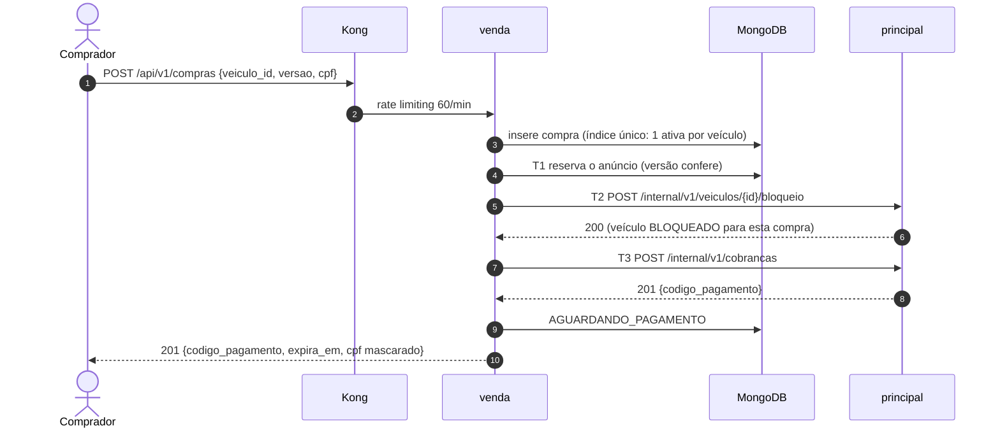
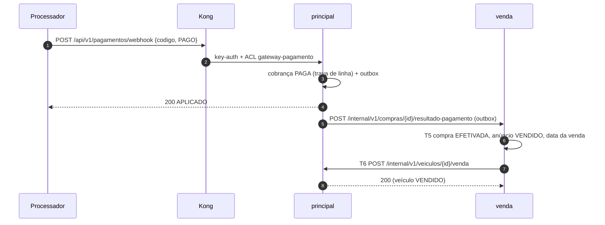
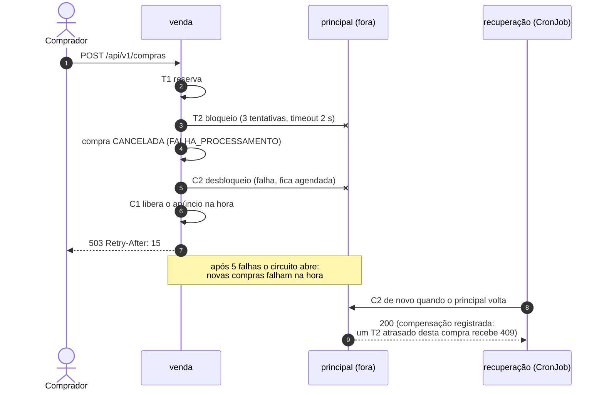
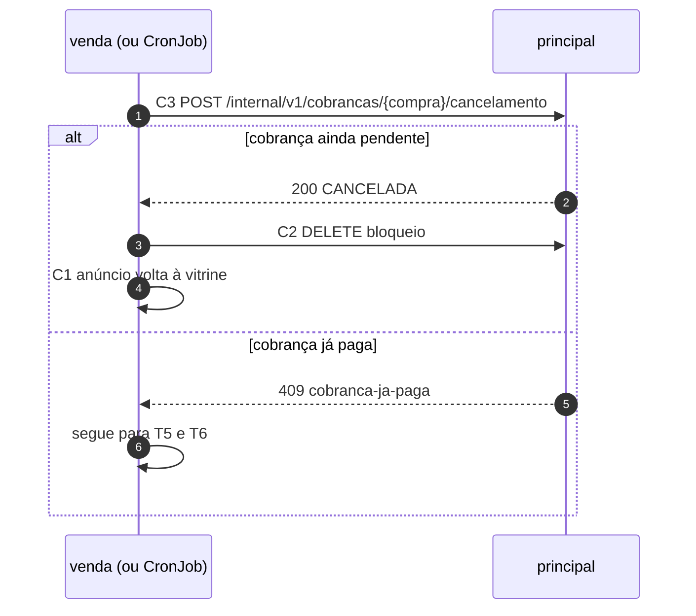

# 4. Arquitetura

Este documento descreve a solução nos níveis do modelo C4 (contexto, containers e componentes), a implantação e os fluxos principais em diagramas de sequência. As decisões estão nos [ADRs](adrs/README.md); os contratos HTTP em [05](05-api.md).

## 4.1 Visão de alto nível

### 4.1.1 Estilo arquitetural

| Escolha | Motivo | ADR |
|---|---|---|
| Dois microsserviços: **principal** (catálogo, cobrança, webhook) e **venda** (vitrine, compra, saga) | O enunciado pede listagens e compra isoladas, com banco próprio | [001](adrs/ADR-001-decomposicao-em-dois-servicos.md) |
| Comunicação síncrona HTTP para os passos da saga; **outbox transacional** para o que o principal precisa entregar ao serviço de venda | Sem broker de mensagens; entrega garantida sem perder a simplicidade | [003](adrs/ADR-003-http-com-outbox.md) |
| **Saga orquestrada** pelo serviço de venda, com compensações e regra contra ressurreição | A compra atravessa dois bancos; não há transação distribuída | [002 do serviço de venda](https://github.com/Caina-Climaco/fiap-soat-revenda-vendas/blob/main/docs/adrs/ADR-002-saga-orquestrada.md) |
| **Réplica de leitura** dos anúncios no serviço de venda | A vitrine responde mesmo com o principal fora do ar | [003 do serviço de venda](https://github.com/Caina-Climaco/fiap-soat-revenda-vendas/blob/main/docs/adrs/ADR-003-replica-de-leitura-dos-anuncios.md) |
| **Clean Architecture** em cada serviço (domínio, aplicação, infraestrutura, interfaces) | Domínio testável sem framework; regras verificadas pelo import-linter | [002](adrs/ADR-002-stack-e-postgresql-no-principal.md) |
| **API Gateway** (Kong) como única entrada; autorização na borda por consumer | Sem Keycloak nesta fase; identidade do gestor e do processador por chave | [005](adrs/ADR-005-sem-keycloak-autorizacao-na-borda.md) |
| **Resiliência** entre os serviços: timeout, retry com jitter, circuit breaker, bulkhead | Falha do principal não pode travar a vitrine nem deixar a compra pela metade | [004](adrs/ADR-004-resiliencia-entre-servicos.md) |
| **Tracing distribuído** (OpenTelemetry, Jaeger) além de métricas e logs | Uma compra passa por cinco componentes | [007](adrs/ADR-007-tracing-distribuido-opentelemetry.md) |

### 4.1.2 Atributos de qualidade priorizados

| Atributo | Como a arquitetura atende | Requisito |
|---|---|---|
| Consistência | Uma compra ativa por veículo (índice único parcial); passos idempotentes pela `compra_id`; a cobrança decide a corrida entre pagamento e expiração | RNF-02, RNF-03 |
| Disponibilidade | Vitrine na réplica local; 2 a 5 réplicas por serviço; rollout sem indisponibilidade | RNF-01, RNF-09 |
| Resiliência | Falha antes do pivô desfaz a compra na hora; depois do pivô, a saga só anda para frente; recuperação a cada minuto | RF-09, RF-10, RNF-04 |
| Segurança e privacidade | Borda única, rotas internas fora do Kong, NetworkPolicies, CPF cifrado e mascarado | RNF-06 a RNF-08 |
| Observabilidade | Métricas, logs JSON e traces correlacionados | RNF-14 |
| Evolutividade | Contratos versionados e testados nos dois lados; deploy independente | RNF-13, RNF-15 |

## 4.2 C4 nível 1: Contexto



| Ator | Interação | Autenticação |
|---|---|---|
| Gestor | Cadastro, edição e consulta dos veículos | Header `apikey` do consumer `gestor` no Kong |
| Comprador e visitante | Vitrine, compra, consulta da compra | Nenhuma (rate limiting no Kong) |
| Processador de pagamentos | Webhook com o resultado do pagamento | `apikey` do consumer `gateway-pagamento` e `X-Webhook-Secret` |

## 4.3 C4 nível 2: Containers



| Container | Tecnologia | Responsabilidade | Dados |
|---|---|---|---|
| Kong | Kong 3.9 DB-less | Roteamento, key-auth + ACL, rate limiting, correlation-id, tracing na borda | Nenhum |
| revenda-principal | Python 3.12, FastAPI, SQLAlchemy | Catálogo (veículo e versão), cobrança, webhook, passos T2/T3/T6 e compensações C2/C3, outbox | `principal-db` |
| revenda-vendas | Python 3.12, FastAPI, PyMongo | Vitrine (réplica), compra por CPF, orquestração da saga | `vendas-db` |
| revenda-vendas-recuperacao | Mesma imagem, CronJob | Expira reservas, retoma sagas paradas, repete compensações, apaga CPF retido | `vendas-db` |
| principal-db | PostgreSQL 16 | Schemas `catalogo`, `pagamentos`, `mensageria` | Sem dados pessoais |
| vendas-db | MongoDB 7 | Coleções `anuncios` e `compras` | CPF cifrado (AES-256-GCM) |
| Prometheus, Grafana | v3.14, 13.2 | Métricas, alertas e painéis | Séries temporais (2 dias) |
| OTel Collector, Jaeger | 0.162, 2.20 | Recebe, filtra (LGPD) e armazena traces | Traces em memória |

## 4.4 C4 nível 3: Componentes

### 4.4.1 Serviço principal



- Cada caso de uso roda numa transação (Unit of Work). A mensagem da outbox é gravada **na mesma transação** da mudança de negócio: anúncio publicado se e só se o veículo mudou; resultado repassado se e só se a cobrança mudou.
- O relay roda em segundo plano em cada réplica; `FOR UPDATE SKIP LOCKED` divide o trabalho e a ordem por agregado impede que a versão 2 do anúncio chegue antes da 1.
- No mesmo laço, uma vez por hora, a limpeza periódica apaga as mensagens entregues há mais de 7 dias e as marcas de compensação com mais de 30 dias. Ela não conhece as tabelas: a outbox é apagada pela mensageria e as marcas pelo repositório do Catálogo, e só `composicao.py` liga as peças (contrato do import-linter). Mensagens em FALHOU voltam para a fila pelo CLI `python -m principal.outbox reprocessar`.

### 4.4.2 Serviço de venda



- O estado da saga mora no documento da compra (passos iniciados e concluídos, compensações pendentes, tentativas, lease). Um **lease** garante um executor por compra; a **revisão** detecta quem mudou o documento no meio.
- Os participantes traduzem as respostas do principal: 2xx conclui o passo, 404/409 com tipo do problema é recusa de negócio, 5xx e erro de rede são falha transitória (o cliente repete e o circuito conta).

## 4.5 Implantação



| Porta no PC (127.0.0.1) | NodePort | Destino |
|---|---|---|
| 8080 | 30080 | Kong |
| 15432 | 30432 | PostgreSQL do principal (demonstração) |
| 27017 | 30017 | MongoDB do serviço de venda (demonstração) |
| 3000 | 30300 | Grafana |
| 9090 | 30900 | Prometheus |
| 16686 | 30686 | Jaeger |

Infraestrutura como código: Terraform em cada repositório (o principal cria a plataforma; o de venda, o namespace `vendas`) e manifestos kustomize aplicados pelo CD. Detalhes em [08](08-ci-cd.md).

## 4.6 Diagramas de sequência

### 4.6.1 Cadastro e réplica do anúncio



### 4.6.2 Compra (T1 a T3)



### 4.6.3 Pagamento efetuado (pivô T4, T5 e T6)



### 4.6.4 Falha do principal antes do pivô



### 4.6.5 Pagamento cancelado ou reserva expirada

A cobrança é a árbitra: o serviço de venda pede o cancelamento (C3) e só desfaz a compra se ele vencer. Se a cobrança já estiver paga (o webhook chegou um instante antes), a compra segue para a efetivação.



## 4.7 Visão de baixo nível

### 4.7.1 Organização de pastas (os dois serviços)

```text
src/<servico>/
  <contexto>/domain/          entidades, objetos de valor, eventos, portas de repositório
  <contexto>/application/     casos de uso (orquestram domínio e portas)
  <contexto>/infrastructure/  repositórios, clientes HTTP, cifra
  <contexto>/interfaces/      routers FastAPI e esquemas Pydantic
  shared/                     config, banco, erros RFC 9457, logs, métricas, tracing
  composicao.py               injeção de dependências
  main.py                     app factory
```

### 4.7.2 Regra de dependência

`interfaces → application → domain`; `infrastructure` implementa as portas do domínio e da aplicação. O domínio não importa FastAPI, SQLAlchemy nem PyMongo; os contextos do principal (`catalogo`, `pagamentos`) não se importam entre si, e os módulos de topo que não são a composição (como `limpeza.py`) não importam os contextos nem a mensageria. O **import-linter** quebra o CI se uma importação violar essas regras, e um teste de arquitetura confere o mesmo.
