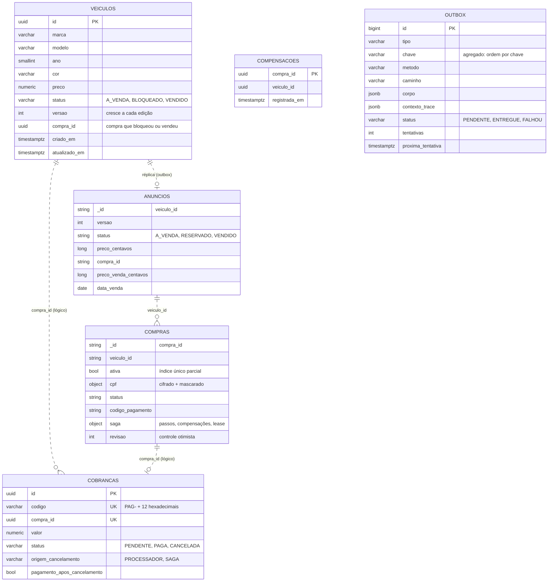

# 6. Modelo de dados

## 6.1 Visão geral das bases

| Base | Serviço | Tecnologia | Conteúdo | Dados pessoais |
|---|---|---|---|---|
| `revenda_principal` | principal | PostgreSQL 16 | Schemas `catalogo` (veículos, compensações), `pagamentos` (cobranças), `mensageria` (outbox) | Nenhum |
| `revenda_vendas` | venda | MongoDB 7.0 | Coleções `anuncios` (réplica da vitrine) e `compras` (com o estado da saga) | CPF do comprador, cifrado |

Cada banco só é alcançável pelo seu serviço (NetworkPolicy) e não existe chave estrangeira entre eles: a ligação é pelos identificadores (`veiculo_id`, `compra_id`), e a coerência entre os dois lados é responsabilidade da saga ([02, seção 2.8](02-modelagem-ddd.md#28-saga-da-compra)).

## 6.2 Diagrama



As linhas pontilhadas não são chaves estrangeiras: são referências lógicas entre bancos diferentes.

## 6.3 PostgreSQL do principal

### 6.3.1 `catalogo.veiculos`

| Coluna | Tipo | Regra |
|---|---|---|
| `id` | uuid | PK |
| `marca`, `modelo`, `cor` | varchar 60/60/30 | Obrigatórios, sem caracteres de controle |
| `ano` | smallint | `CHECK ano BETWEEN 1950 AND 2100` (o limite superior real, ano corrente + 1, é validado no domínio) |
| `preco` | numeric(12,2) | `CHECK preco > 0` |
| `status` | varchar | `CHECK status IN ('A_VENDA','BLOQUEADO','VENDIDO')` |
| `versao` | int | `CHECK versao >= 1`; muda só na edição e viaja na réplica |
| `compra_id` | uuid | Preenchido quando BLOQUEADO ou VENDIDO (CHECK de coerência com o status) |

Índice `ix_veiculos_status_criado_em (status, criado_em)` para a listagem do gestor por status.

### 6.3.2 `catalogo.compensacoes`

Uma linha por compra compensada (C2). É a **regra contra ressurreição**: um T2 atrasado de uma compra que já foi compensada recebe 409 `compra-compensada` em vez de bloquear o veículo de novo. O caso de uso trava a linha do veículo antes de consultar esta tabela, então a corrida entre T2 atrasado e C2 é decidida pelo banco.

### 6.3.3 `pagamentos.cobrancas`

| Coluna | Regra |
|---|---|
| `codigo` | Único; é o "código do pagamento" do enunciado |
| `compra_id` | Único: uma cobrança por compra (T3 idempotente) |
| `status` | `PENDENTE`, `PAGA` ou `CANCELADA`, com trava de linha nas transições |
| `origem_cancelamento` | `PROCESSADOR` (webhook) ou `SAGA` (C3 por expiração ou desistência) |
| `pagamento_apos_cancelamento` | Marca o caso raro de PAGO chegar depois do cancelamento: vai para estorno manual e dispara alerta |

### 6.3.4 `mensageria.outbox`

| Coluna | Uso |
|---|---|
| `tipo`, `chave` | Tipo da mensagem e agregado; mensagens da mesma chave saem na ordem do `id` |
| `metodo`, `caminho`, `corpo` | A requisição HTTP que o relay vai fazer ao serviço de venda |
| `contexto_trace` | `traceparent` do momento da gravação: a entrega continua o mesmo trace |
| `status`, `tentativas`, `proxima_tentativa`, `ultimo_erro` | Backoff exponencial até 60 s, sem limite de tentativas para rede e 5xx; `FALHOU` só por erro definitivo (4xx que não seja 404, 408, 425 ou 429; o 409 de resultado divergente também é definitivo) ou quando a mensagem passa do prazo de entrega (`OUTBOX_PRAZO_ENTREGA_HORAS`, padrão 24 h). `python -m principal.outbox reprocessar` devolve as `FALHOU` a `PENDENTE` depois de corrigida a causa, com o prazo recontado a partir do reprocessamento |

Índices parciais `WHERE status = 'PENDENTE'`: `(proxima_tentativa, id)` para o relay e `(chave, id)` para garantir a ordem por agregado.

## 6.4 MongoDB do serviço de venda

### 6.4.1 `anuncios`

`_id` é o `veiculo_id`. Dinheiro em **centavos inteiros** (`preco_centavos`, `preco_venda_centavos`), para a ordenação e a comparação serem exatas.

| Operação | Atomicidade |
|---|---|
| Réplica (`PUT /internal/v1/anuncios`) | `update_one` com filtro `versao < recebida`; nunca muda a disponibilidade (status, compra) |
| T1 reservar | `find_one_and_update` com filtro `status = A_VENDA e versao = informada` |
| C1 liberar, T5 vender | `update_one` com filtro `compra_id = esta compra` |

Índices: `ix_vitrine_a_venda (status, preco_centavos, criado_em)` e `ix_vitrine_vendidos (status, preco_venda_centavos, data_venda)`, que cobrem a ordenação das duas listagens.

### 6.4.2 `compras`

`_id` é o `compra_id`. O documento guarda a compra e o estado da saga:

| Campo | Uso |
|---|---|
| `ativa` | `true` enquanto a compra pode virar venda; índice **único parcial** `ux_compra_ativa_por_veiculo` em `veiculo_id` com `ativa = true` (RN-03, RNF-02) |
| `cpf.cifrado` | AES-256-GCM com o `compra_id` como dado associado e o identificador da chave (`kid`) |
| `cpf.mascarado` | `***.982.247-**`; é o que as respostas mostram |
| `saga.iniciados`, `saga.concluidos` | Passos T1 a T6; o passo é marcado como iniciado **antes** da chamada remota |
| `saga.compensacoes_pendentes`, `saga.compensacoes_feitas` | C3, C2, C1, em ordem inversa aos passos iniciados |
| `saga.tentativas`, `saga.proxima_tentativa`, `saga.ultimo_erro` | Backoff de 2 s a 5 min entre tentativas |
| `saga.lease_ate`, `saga.dono_lease` | Um executor por compra (réplica da API ou CronJob) |
| `revisao` | Controle otimista: toda gravação confere a revisão lida |

Índice `ix_recuperacao (status, saga.proxima_tentativa)` para a recuperação achar o que tem trabalho pendente.

Não há transação entre documentos (o MongoDB roda sem replica set, [ADR-001 do serviço de venda](https://github.com/Caina-Climaco/fiap-soat-revenda-vendas/blob/main/docs/adrs/ADR-001-mongodb.md)): cada passo é atômico num documento, e o que fica pela metade entre o anúncio e a compra é resolvido pela saga, que sabe quais passos iniciou.

## 6.5 Migrações e índices

| Serviço | Como |
|---|---|
| principal | Alembic, executado pelo Job `principal-migracao` antes de cada rollout (`python -m principal.migracao`). Tolerante a rollback: se o banco estiver numa revisão que a imagem não conhece, termina com sucesso sem tocar no banco. Migrações aditivas (expandir e depois contrair) |
| venda | `garantir_indices()` na subida da API e do CronJob, idempotente; sem esquema rígido, os campos novos entram com valor padrão na leitura |

## 6.6 Retenção e LGPD

| Dado | Retenção |
|---|---|
| CPF de compra efetivada | Mantido (prova da venda e emissão de documentos) |
| CPF de compra cancelada | Apagado pela recuperação após 90 dias (`RETENCAO_CPF_DIAS`); o campo mascarado vai junto |
| Outbox entregue | Apagada 7 dias depois da entrega (`OUTBOX_RETENCAO_DIAS`), pela limpeza periódica no laço do relay; pendentes e `FALHOU` nunca são apagadas |
| Marcas da regra contra ressurreição (`catalogo.compensacoes`) | Apagadas depois de 30 dias (`COMPENSACOES_RETENCAO_DIAS`), pela mesma limpeza: nenhum passo da saga chega com dias de atraso |

Detalhes em [07, seção 5](07-seguranca-lgpd.md#75-lgpd).

## 6.7 Backup (ambiente local)

Os bancos rodam com volume persistente (PVC `standard` do kind, 1 GiB cada). É um ambiente de demonstração: não há backup automático. Para guardar um estado:

```bash
kubectl -n principal exec statefulset/principal-db -- pg_dump -U revenda revenda_principal > principal.sql
kubectl -n vendas exec statefulset/vendas-db -- sh -c 'mongodump --archive -u root -p "$MONGO_INITDB_ROOT_PASSWORD" --authenticationDatabase admin' > vendas.archive
```
