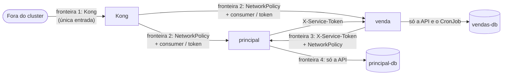

# 7. Segurança e LGPD

Este documento descreve as fronteiras de confiança, as ameaças consideradas, os controles implementados nos dois serviços e na plataforma, e o tratamento do CPF do comprador à luz da Lei Geral de Proteção de Dados (Lei 13.709/2018).

## 7.1 Ativos e fronteiras de confiança

| Ativo | Onde | Por que importa |
|---|---|---|
| CPF do comprador | `vendas-db`, coleção `compras` | Único dado pessoal da solução |
| Estado do catálogo e das cobranças | `principal-db` | Integridade da venda: um veículo não pode ser vendido duas vezes nem marcado como pago sem pagamento |
| Chaves dos consumers do Kong | Secret `gateway/consumidores-kong` | Quem tem a chave do gestor edita o catálogo; a do processador confirma pagamentos |
| Segredo do webhook e tokens de serviço | Secrets dos namespaces `principal` e `vendas` | Forjar um pagamento ou um passo da saga |
| Chave AES do CPF | Secret `vendas/vendas-cpf` | Decifra os CPFs gravados |

## 7.2 Modelo de ameaças (STRIDE)

| Ameaça | Exemplo | Controle |
|---|---|---|
| **S**poofing | Chamar a rota do gestor fingindo ser ele; forjar o header `X-Consumer-Username` | key-auth no Kong; o Kong sobrescreve o header; NetworkPolicy impede chegar ao principal sem passar pelo Kong (e2e: header forjado sem chave recebe 401) |
| **S**poofing | Forjar o webhook de pagamento | Chave do consumer `gateway-pagamento` + ACL no Kong e `X-Webhook-Secret` conferido em tempo constante no principal |
| **S**poofing | Um pod qualquer chamar `/internal/v1` | Rotas internas sem rota no Kong (404); NetworkPolicy só deixa o outro serviço entrar; `X-Service-Token` por direção |
| **T**ampering | Alterar preço ou versão entre a vitrine e a compra | O comprador envia a versão vista; T1 e T2 conferem; divergência dá 409 `anuncio-alterado` |
| **T**ampering | Reprocessar um passo da saga depois da compensação | Regra contra ressurreição (`catalogo.compensacoes`): 409 `compra-compensada` |
| **R**epudiation | Contestar quem cadastrou, editou ou pagou | Logs JSON com `request_id`, consumer e `trace_id`; eventos de domínio registrados |
| **I**nformation disclosure | CPF em resposta, log, métrica ou trace | CPF mascarado nas respostas, nunca logado; o formatador de log do serviço de venda mascara qualquer sequência com formato de CPF; Collector remove atributos com `cpf`; testes que inspecionam os logs |
| **I**nformation disclosure | Enumerar compras por CPF | Não existe busca por CPF; a consulta é pelo identificador da compra (UUID v4, não sequencial) |
| **D**enial of service | Esgotar a API ou travar a compra | Rate limiting no Kong (600/min geral, 60/min no POST de compra); limite de payload de 1 MB; HPA; circuit breaker e bulkhead entre os serviços |
| **E**levation of privilege | Container comprometido ganhar o nó | Usuário não root, raiz somente leitura, `drop ALL`, seccomp `RuntimeDefault`, sem token de service account |

## 7.3 Controles

### 7.3.1 Autenticação e autorização

Nesta fase não há Keycloak ([ADR-005](adrs/ADR-005-sem-keycloak-autorizacao-na-borda.md)): os únicos atores autenticados são sistemas ou um operador da loja, e o comprador não tem conta.

| Quem | Como se identifica | Onde é verificado |
|---|---|---|
| Gestor | `apikey` do consumer `gestor` | Kong (key-auth + ACL); o principal exige `X-Consumer-Username: gestor` |
| Processador | `apikey` do consumer `gateway-pagamento` + `X-Webhook-Secret` | Kong e principal (defesa em profundidade) |
| Serviço para serviço | `X-Service-Token` (um segredo por direção) | Serviço chamado, comparação em tempo constante |
| Comprador | Nenhuma | Rate limiting; a compra só expõe o CPF mascarado |

### 7.3.2 Menor privilégio na rede

| NetworkPolicy | Quem pode entrar |
|---|---|
| `principal-db-somente-api` | `revenda-principal` e o Job de migração |
| `revenda-principal-entrada` | Kong, pods do serviço de venda (API e CronJob), Prometheus |
| `vendas-db-somente-servico` | `revenda-vendas` e o CronJob de recuperação |
| `revenda-vendas-entrada` | Kong, `revenda-principal` (outbox), Prometheus |

Os bancos aceitam também o tráfego do host quando a demonstração está ligada (`expor_banco = true`), só em `127.0.0.1`.

No MongoDB, a aplicação usa um usuário com `readWrite` apenas no banco `revenda_vendas`; o usuário root existe só para a inicialização.

### 7.3.3 Gestão de segredos

- Todos os segredos são gerados pelo Terraform (`random_password`, `random_bytes`) e ficam só no state local (fora do repositório) e nos Secrets do cluster; nenhuma saída do Terraform mostra valores.
- Os tokens de serviço são gerados no repositório principal e lidos pelo Terraform do serviço de venda por um Secret de contrato: nenhum segredo trafega por arquivo ou variável de CI.
- O CI não tem segredo além do `SONAR_TOKEN`; o CD lê as chaves do cluster e as mascara no log (`::add-mask::`).
- Rotação: `terraform apply -replace=random_password.<nome>` e reimplantação; para os tokens, um `apply` em cada repositório.

### 7.3.4 Cadeia de suprimentos e containers

- Actions fixadas por SHA de commit; imagens base e ferramentas com versão e checksum (kind, kubectl, Terraform conferido pela assinatura da HashiCorp).
- Trivy no CI: CVE crítica corrigível na imagem bloqueia o PR; varredura de segredos no repositório.
- SonarCloud com Quality Gate (bugs, vulnerabilidades, hotspots de segurança).
- Imagem sem dependências de desenvolvimento, usuário 10001, `readOnlyRootFilesystem`.

### 7.3.5 Transporte

No ambiente local o tráfego é HTTP dentro do cluster e na porta do Kong em `127.0.0.1`. Em produção: TLS no Kong (certificado gerenciado), mTLS entre os serviços por service mesh, e o token de serviço substituído por identidade de workload.

### 7.3.6 Logs, auditoria e tracing

Logs JSON com `request_id`, `trace_id`, consumer e rota; sem corpo de requisição, sem CPF, sem segredos (teste automatizado nos dois serviços). Os spans do OpenTelemetry não recebem corpo nem parâmetros de SQL, e o Collector remove atributos com `cpf`, `apikey`, `X-Webhook-Secret` e `X-Service-Token` como segunda barreira. No serviço de venda, o formatador de log é outra barreira: mascara qualquer sequência com formato de CPF (11 dígitos, com ou sem pontuação) na linha inteira, inclusive em tracebacks.

## 7.4 OWASP API Security Top 10 (2023)

| Risco | Situação |
|---|---|
| API1 Broken Object Level Authorization | A compra é consultada por UUID v4 e só mostra o CPF mascarado; o gestor é o único ator com acesso ao catálogo inteiro |
| API2 Broken Authentication | Chaves de consumer e tokens gerados com 40 a 48 caracteres; comparação em tempo constante |
| API3 Broken Object Property Level Authorization | Esquemas Pydantic recusam campos desconhecidos (422); respostas montadas por esquema explícito |
| API4 Unrestricted Resource Consumption | Rate limiting, limite de payload, paginação com máximo de 100, timeouts e bulkhead |
| API5 Broken Function Level Authorization | ACL por rota no Kong; rotas internas fora do Kong |
| API6 Unrestricted Access to Sensitive Business Flows | Uma compra ativa por veículo; rate limiting mais restrito no POST de compra; reserva expira em 30 minutos |
| API7 Server Side Request Forgery | Os serviços só chamam endereços fixos de configuração |
| API8 Security Misconfiguration | Admin API do Kong só em `127.0.0.1` do pod; Kong Manager desligado; erros em problem+json sem stack trace |
| API9 Improper Inventory Management | OpenAPI dos dois serviços publicada; contratos internos versionados e testados |
| API10 Unsafe Consumption of APIs | Respostas do outro serviço tratadas por status e tipo de problema; contrato testado nos dois lados |

## 7.5 LGPD

### 7.5.1 Papéis e dado tratado

A revenda é a **controladora** (art. 5º, VI): é ela quem decide sobre o tratamento do CPF. Não há operador externo (art. 5º, VII), porque todos os componentes são operados pela própria revenda.

| Dado | Finalidade | Onde fica | Forma |
|---|---|---|---|
| CPF do comprador | Identificar o comprador no contrato de compra e venda e na documentação do veículo | `vendas-db.compras` | Cifrado (AES-256-GCM) e mascarado |

Nenhum dado pessoal sensível (art. 5º, II) é tratado. O serviço principal, os logs, as métricas e os traces não têm dado pessoal.

### 7.5.2 Princípios aplicados (art. 6º)

| Princípio | Aplicação |
|---|---|
| Finalidade (I) e adequação (II) | O CPF só é usado para identificar o comprador da compra |
| Necessidade (III) | É o único dado pessoal pedido; não há nome, e-mail ou telefone nesta fase |
| Segurança (VII) e prevenção (VIII) | Cifra em repouso, máscara nas respostas, ausência em logs e traces, banco isolado por rede, decididos desde a concepção ([ADR-005 do serviço de venda](https://github.com/Caina-Climaco/fiap-soat-revenda-vendas/blob/main/docs/adrs/ADR-005-cpf-lgpd.md)) |

O art. 46 obriga o agente de tratamento a adotar medidas de segurança técnicas e administrativas aptas a proteger os dados de acessos não autorizados e de incidentes; o § 2º manda observá-las desde a concepção do produto. Os controles da seção 7.3 são a resposta técnica a esse dever.

### 7.5.3 Base legal

- **Compra em andamento**: art. 7º, V, execução de contrato ou de procedimentos preliminares a pedido do titular. O comprador informa o CPF para comprar; sem ele não há contrato.
- **Compra efetivada**: a conservação depois da venda se apoia no art. 7º, II, e no art. 16, I, cumprimento de obrigação legal ou regulatória, como as obrigações fiscais e a documentação de transferência do veículo.

O consentimento (art. 7º, I) não é a base adequada: o tratamento é condição da própria compra, e não uma escolha revogável sem prejuízo do contrato.

### 7.5.4 Cifra não é anonimização

O CPF é guardado cifrado com AES-256-GCM, com o identificador da compra como dado associado (a cifra de uma compra não pode ser copiada para outra) e o identificador da chave gravado junto, para permitir rotação. Isso protege o dado num vazamento do banco ou de um backup, mas **o dado continua sendo pessoal**: a controladora tem a chave e consegue decifrá-lo. Dado anonimizado (art. 5º, III, e art. 12) é o que não pode mais ser associado ao titular por meios razoáveis, o que não é o caso.

### 7.5.5 Retenção e término do tratamento (arts. 15 e 16)

| Situação | O que acontece |
|---|---|
| Compra cancelada (pagamento cancelado, reserva expirada ou falha) | O CPF é apagado pela recuperação após 90 dias (`RETENCAO_CPF_DIAS`), prazo para atendimento de reclamações sobre a compra não concluída; depois disso a compra fica sem dado pessoal |
| Compra efetivada | O CPF é mantido para as obrigações legais (art. 16, I); o prazo de guarda é definido pela política fiscal da revenda |

### 7.5.6 Direitos do titular (art. 18)

| Direito | Como é atendido |
|---|---|
| Confirmação e acesso (I e II) | O comprador consulta a própria compra pelo identificador; a resposta mostra o CPF mascarado. O acesso ao CPF completo é feito pela loja, sob pedido, por procedimento administrativo |
| Correção (III) | CPF errado invalida a compra (os dígitos são validados na entrada); o comprador faz nova compra |
| Eliminação de dados desnecessários (IV) e término do tratamento (art. 15) | Compras canceladas têm o CPF apagado automaticamente; para as efetivadas vale a ressalva do art. 16, I |
| Portabilidade (V) e informação sobre compartilhamento (VII) | Procedimento administrativo; não há compartilhamento com terceiros |

O inciso VI (eliminação dos dados tratados com consentimento) não se aplica diretamente, porque a base legal é a execução do contrato; a eliminação decorre do término do tratamento (art. 15), ressalvadas as hipóteses de conservação do art. 16.

### 7.5.7 Obrigações organizacionais

Registro das operações de tratamento (art. 37), encarregado (art. 41), política de privacidade e comunicação de incidentes à ANPD e aos titulares (art. 48) são obrigações da revenda como organização. A arquitetura reduz o escopo de um incidente: o único dado pessoal está num único banco, cifrado, alcançável só pelo serviço de venda.
